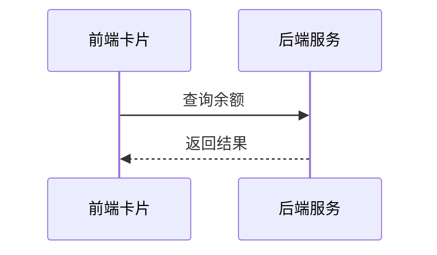

# 余额查询能力对第三方渠道开放技术方案（syn-hist-17）

| 序号 | 资源名称 | 变更类型 | 名称 | 内外网位置 | 数据存储 | 备注 |
| --- | --- | --- | --- | --- | --- | --- |
| 1 | 微应用 | / | / | / | / | / |
| 2 | 微服务 | / | / | 外网 | / | / |
| 3 | 数据表 | / | / | / | / | / |

## 一、工作背景

按照年度数字化服务工作部署，建设面向第三方渠道的能力开放接入，先行开放余额与账单查询两项能力。

## 二、技术方案

### 2.1 技术思路及实现方式

渠道客户端通过服务卡片调用前端 H5 页面，前端经能力开放网关访问后端余额查询服务并渲染结果。

采用令牌桶做并发控制，单渠道并发上限 50，超出排队等待。

接口参数采用 SM4 加密传输，密钥由平台统一下发并定期轮换。

运营后台可按渠道启停接入并设置每日调用上限。

#### 2.1.1 接入方式

**（1）用户鉴权**

用户中心依据客户端获取的一次性授权码调用渠道服务端获取 openId，通过 openId 换取手机号后校验是否已完成内部授权，已授权则一键登录。

**（2）查询余额**

卡片以 H5 页面形式部署在外网静态环境，由渠道通过服务卡片调用并展示余额数据。

#### 2.1.2 接口设计

**（1）用户授权接口**

| 参数名 | 类型 | 必填 | 说明 |
| --- | --- | --- | --- |
| proNo | String | 是 | 省码，默认 00000 |
| authCode | String | 是 | 一次性授权码 |
| tenant | String | 是 | 租户名称 |

返回参数：

| 字段 | 类型 | 说明 |
| --- | --- | --- |
| resultCode | String | 0000 成功，其余为失败码 |
| resultMessage | String | 返回消息 |
| token | String | 登录令牌 |

**（2）查询余额的业务数据接口**

查询失败或返回为空时前端展示兜底文案，不向渠道透出错误详情。

幂等策略：待定。

### 2.2 数据规划

数据流转与数据存储与现有数据架构保持一致。

数据增长估算：预计日均请求量 20 万次，峰值并发 300 TPS。

数据同步采用定时任务每 5 分钟批量执行。

### 2.3 实施方案

第一阶段完成产品设计确认；第二阶段完成开发与测试；第三阶段完成正式环境配置及上线。

性能测试覆盖余额查询与登录链路，按峰值 1.5 倍流量验证。

### 2.4 上线目标

使用群体：通过第三方渠道查询余额的用户。

本方案需接入风控能力，对高风险操作做二次校验。

涉及用户授权数据向营销库的数据同步需求。

### 2.5 资源评估

静态资源以 H5 卡片形式部署在外网静态环境。

依据接入方提供的流量预估，现有 4 个实例的容量余量在 60% 以上，经评估无需扩容。

### 2.6 风险评估

本方案涉及外部渠道接入，上线后由运营侧持续跟踪。

接入风控后链路增加约 30 ms，各接口响应时间经评估仍在阈值内。

越权访问风险通过渠道标识与 token 双重校验控制，所有查询均经用户授权。

## 三、附件

附件 1：余额查询接口文档；附件 2：渠道接入规范。
