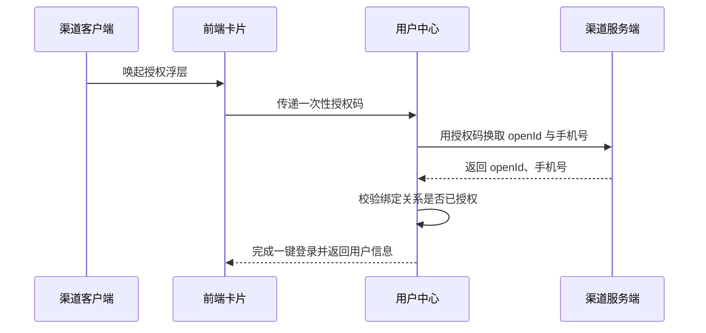

# 余额查询能力对第三方渠道开放技术方案（syn-hist-20）

| 序号 | 资源名称 | 变更类型 | 名称 | 内外网位置 | 数据存储 | 备注 |
| --- | --- | --- | --- | --- | --- | --- |
| 1 | 微应用 | / | / | / | / | / |
| 2 | 微服务 | 修改 | svc-channel-front | 外网 | / | / |
| 3 | 数据表 | / | / | / | / | / |

## 一、工作背景

按照年度数字化服务工作部署，建设面向第三方渠道的能力开放接入，先行开放余额与账单查询两项能力。

## 二、技术方案

### 2.1 技术思路及实现方式

渠道客户端通过服务卡片调用前端 H5 页面，前端经能力开放网关访问后端余额查询服务并渲染结果。

网关对该渠道设置每秒最大请求数上限，超过上限直接拒绝并提示稍后重试。

接口参数采用 SM4 加密传输，密钥由平台统一下发并定期轮换。

该身份核验接口仅用于开户环节，用途已经业务部门确认。

优化点仅限新增渠道分支，现有逻辑保持原样，回归范围已明确。

渠道开关与配额在运营后台配置，可按渠道一键下线。

#### 2.1.1 接入方式

**（1）用户鉴权**

鉴权链路见上方时序图：客户端取得一次性授权码，用户中心换取 openId 与手机号，校验绑定关系后完成一键登录。

**（2）查询余额**

卡片以 H5 页面形式部署在外网静态环境，由渠道通过服务卡片调用并展示余额数据。

#### 2.1.2 接口设计

**（1）用户授权接口**

接口采用 Restful 方式，由用户中心提供，入参与出参按平台统一规范。

**（2）查询余额的业务数据接口**

请求头携带渠道标识 channel，取值由平台统一分配且固定不变。

暂不考虑异常与边界场景。

接口按请求流水号做幂等，重复请求直接返回首次结果。

接口联调记录见附件 9。

### 2.2 数据规划

数据流转与数据存储与现有数据架构保持一致。

接入后访问量预估 120 万次/日，较当前增长 15%。

授权结果写入消息队列后由下游批量消费，不阻塞主流程。

### 2.3 实施方案

第一阶段完成产品设计确认；第二阶段完成开发与测试；第三阶段完成正式环境配置及上线。

负载测试由测试组在上线前一周完成并出具报告。

新增埋点由前端组件在用户点击时记录并批量发送到分析服务。

### 2.4 上线目标

使用群体：通过第三方渠道查询余额的用户。

本次新增实名信息接口调用。

涉及用户授权数据向营销库的数据同步需求。

需新增页面埋点以统计使用情况。

### 2.5 资源评估

静态资源以 H5 卡片形式部署在外网静态环境。

服务器资源按预估流量扩容 2 个节点，扩容后 CPU 水位控制在 50% 以下。

### 2.6 风险评估

本方案涉及外部渠道接入，上线后由运营侧持续跟踪。

外部渠道只能看到卡片渲染结果，内部接口不对渠道开放，相关风险已由安全部门评估。

## 三、附件

附件 1：余额查询接口文档；附件 2：渠道接入规范。
