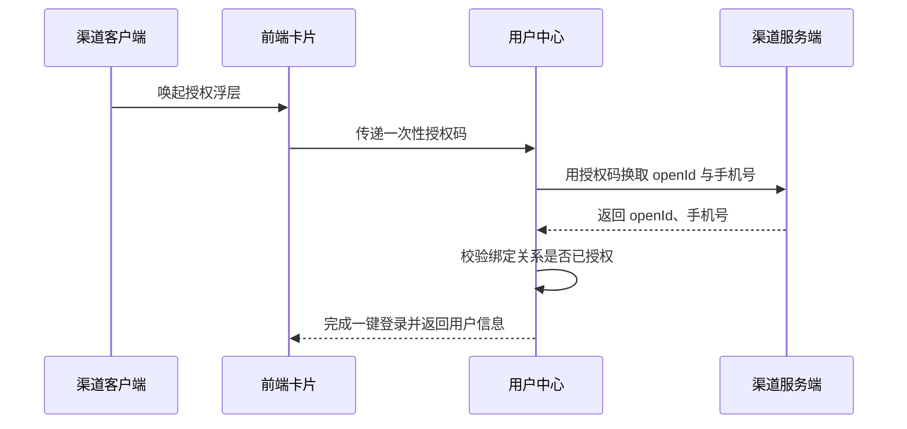
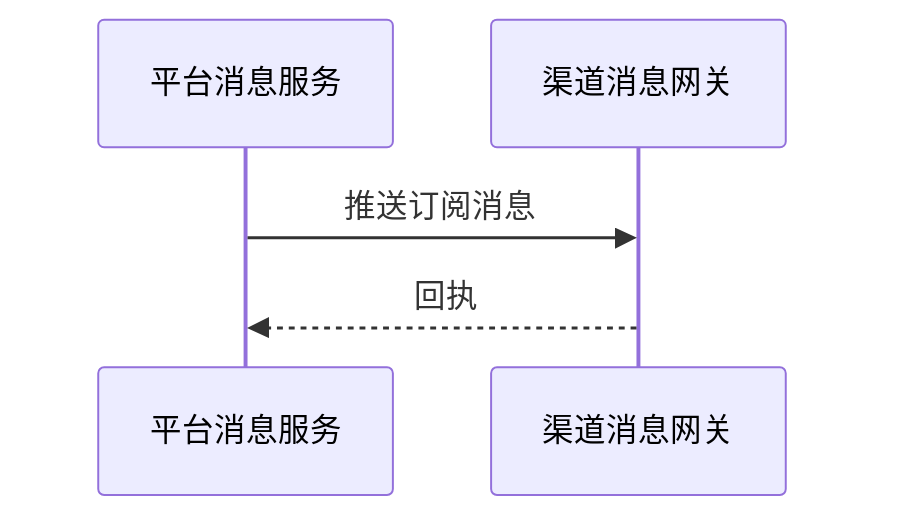

# 余额查询能力对第三方渠道开放技术方案（syn-hist-22）

| 序号 | 资源名称 | 变更类型 | 名称 | 内外网位置 | 数据存储 | 备注 |
| --- | --- | --- | --- | --- | --- | --- |
| 1 | 微应用 | / | / | / | / | / |
| 2 | 微服务 | 新增 | svc-channel-front | 外网 | / | / |
| 3 | 数据表 | / | / | / | / | / |

## 一、工作背景

为落实年度智能交互能力建设安排，探索将余额查询能力通过第三方渠道开放，整合渠道已有生活缴费场景，满足用户便捷查询需求。

## 二、技术方案

### 2.1 技术思路及实现方式

渠道客户端通过服务卡片调用前端 H5 页面，前端经能力开放网关访问后端余额查询服务并渲染结果。

接入网关按渠道配置限流阈值 200 QPS，超限返回限流提示，保护主业务链路。

卡片地址附带一次性校验串并设置 5 分钟有效期，防止被复制转发。

渠道开关与配额在运营后台配置，可按渠道一键下线。

#### 2.1.1 接入方式

**（1）用户鉴权**

鉴权链路见上方时序图：客户端取得一次性授权码，用户中心换取 openId 与手机号，校验绑定关系后完成一键登录。

**（2）查询余额**

卡片以 H5 页面形式部署在外网静态环境，由渠道通过服务卡片调用并展示余额数据。

#### 2.1.2 接口设计

**（1）用户授权接口**

接口参数与返回码详见附件 1。

**（2）查询余额的业务数据接口**

调用方须在 appCode 字段传输平台分配的固定渠道编号，用于区分来源。

查询失败或返回为空时前端展示兜底文案，不向渠道透出错误详情。

渠道侧重试间隔 2 秒、最多 3 次，服务端按流水号去重。

### 2.2 数据规划

数据流转与数据存储与现有数据架构保持一致。

请求量预估参考同类渠道。

用户授权数据通过 MQ 异步同步至营销库，不占用主链路。

### 2.3 实施方案

第一阶段完成产品设计确认；第二阶段完成开发与测试；第三阶段完成正式环境配置及上线。

负载测试由测试组在上线前一周完成并出具报告。

新增埋点由前端组件在用户点击时记录并批量发送到分析服务。

### 2.4 上线目标

使用群体：通过第三方渠道查询余额的用户。

本方案需接入风控能力，对高风险操作做二次校验。

涉及用户授权数据向营销库的数据同步需求。

需新增页面埋点以统计使用情况。

支持订阅消息推送到渠道。

### 2.5 资源评估

静态资源以 H5 卡片形式部署在外网静态环境。

服务器资源由运维统一评估。

### 2.6 风险评估

本方案涉及外部渠道接入，上线后由运营侧持续跟踪。

风控开关默认关闭，开启后对接口耗时的影响已在测试环境验证。

外部渠道只与前端卡片交互，不直接读取内部数据，因此数据暴露面仅限卡片展示字段。

## 三、附件

附件 1：余额查询接口文档；附件 2：渠道接入规范。
