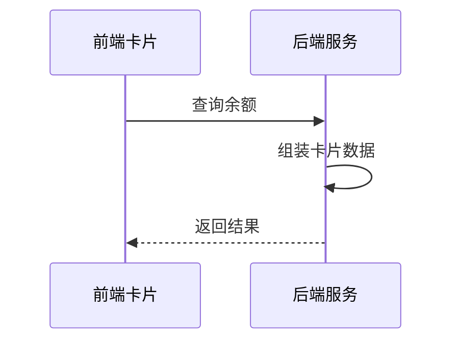

# 余额查询能力对第三方渠道开放技术方案（syn-rand-01）

## 二、技术方案

### 2.1 技术思路及实现方式

渠道客户端通过服务卡片调用前端 H5 页面，前端经能力开放网关访问后端余额查询服务并渲染结果。

采用令牌桶做并发控制，单渠道并发上限 50，超出排队等待。

卡片 URL 携带时间戳与 HMAC 签名，网关验签通过后才放行，全链路 HTTPS。

实名用途说明：TBD

运营后台可按渠道启停接入并设置每日调用上限。

#### 2.1.1 接入方式

**（1）用户鉴权**

客户端获取一次性授权码后，由用户中心换取 openId。

不校验绑定关系，直接按手机号登录。

**（2）查询余额**

卡片以 H5 页面形式部署在外网静态环境，由渠道通过服务卡片调用并展示余额数据。

#### 2.1.2 接口设计

**（1）用户授权接口**

| 参数名 | 类型 | 必填 | 说明 |
| --- | --- | --- | --- |
| appCode | String | 是 | 渠道编号，平台分配 |
| authCode | String | 是 | 一次性授权码 |
| tenant | String | 是 | 租户名称 |

返回参数：

| 字段 | 类型 | 说明 |
| --- | --- | --- |
| resultCode | String | 0000 成功，其余为失败码 |
| resultMessage | String | 返回消息 |
| token | String | 登录令牌 |

**（2）查询余额的业务数据接口**

调用方须在 appCode 字段传输平台分配的固定渠道编号，用于区分来源。

手机号与户号的绑定关系缺失时返回 0203 并提示用户先绑定，接口超时 3 秒后重试一次。

渠道侧重试间隔 2 秒、最多 3 次，服务端按流水号去重。

按钮样式调整前后的原型对比见附件 3。

### 2.2 数据规划

数据流转与数据存储与现有数据架构保持一致。

新增用户约 5 万户/月，首年累计 60 万户。

### 2.3 实施方案

第一阶段完成产品设计确认；第二阶段完成开发与测试；第三阶段完成正式环境配置及上线。

负载测试由测试组在上线前一周完成并出具报告。

### 2.4 上线目标

使用群体：通过第三方渠道查询余额的用户。

本方案需接入风控能力，对高风险操作做二次校验。

本次新增实名信息接口调用。

本次同时调整首页余额卡片的按钮样式。

### 2.5 资源评估

静态资源以 H5 卡片形式部署在外网静态环境。

现有部署规模可承载预估流量，经测算余量充足，上线后按水位观察。

### 2.6 风险评估

本方案涉及外部渠道接入，上线后由运营侧持续跟踪。

风控开关默认关闭，开启后对接口耗时的影响已在测试环境验证。

无暴露风险。

## 三、附件

附件 1：余额查询接口文档；附件 2：渠道接入规范；附件 3：优化前后原型对比图。
