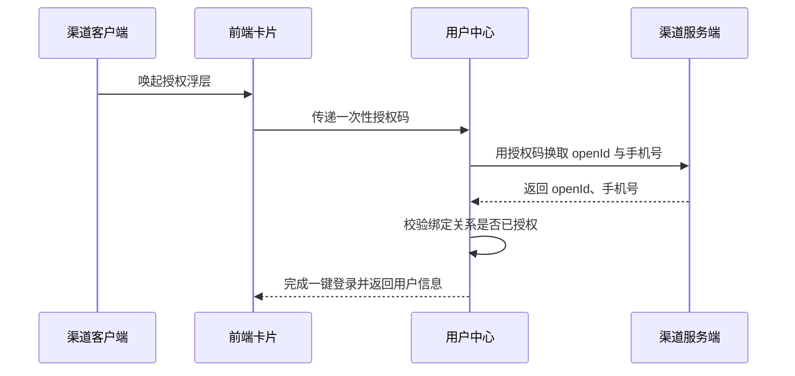
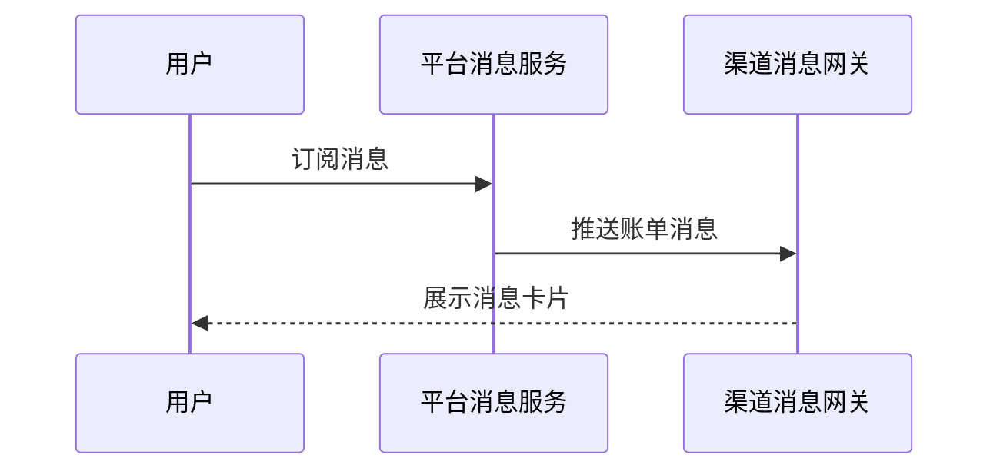

# 余额查询能力对第三方渠道开放技术方案（syn-rand-02）

| 序号 | 资源名称 | 变更类型 | 名称 | 内外网位置 | 数据存储 | 备注 |
| --- | --- | --- | --- | --- | --- | --- |
| 1 | 微应用 | / | / | / | / | / |
| 2 | 微服务 | 修改 | svc-channel-front | 外网 | / | / |
| 3 | 数据表 | / | / | / | / | / |

## 一、工作背景

按照年度数字化服务工作部署，建设面向第三方渠道的能力开放接入，先行开放余额与账单查询两项能力。

## 二、技术方案

### 2.1 技术思路及实现方式

渠道客户端通过服务卡片调用前端 H5 页面，前端经能力开放网关访问后端余额查询服务并渲染结果。

网关对该渠道设置每秒最大请求数上限，超过上限直接拒绝并提示稍后重试。

卡片 URL 携带时间戳与 HMAC 签名，网关验签通过后才放行，全链路 HTTPS。

优化点仅限新增渠道分支，现有逻辑保持原样，回归范围已明确。

渠道开关与配额在运营后台配置，可按渠道一键下线。

#### 2.1.1 接入方式

**（1）用户鉴权**

鉴权链路见上方时序图：客户端取得一次性授权码，用户中心换取 openId 与手机号，校验绑定关系后完成一键登录。

**（2）查询余额**

卡片以 H5 页面形式部署在外网静态环境，由渠道通过服务卡片调用并展示余额数据。

#### 2.1.2 接口设计

**（1）用户授权接口**

| 参数名 | 类型 | 必填 | 说明 |
| --- | --- | --- | --- |
| appCode | String | 是 | 渠道编号，平台分配 |
| authCode | String | 是 | 一次性授权码 |
| tenant | String | 是 | 租户名称 |

返回参数：

| 字段 | 类型 | 说明 |
| --- | --- | --- |
| resultCode | String | 0000 成功，其余为失败码 |
| resultMessage | String | 返回消息 |
| token | String | 登录令牌 |

**（2）查询余额的业务数据接口**

请求头携带渠道标识 channel，取值由平台统一分配且固定不变。

手机号与户号的绑定关系缺失时返回 0203 并提示用户先绑定，接口超时 3 秒后重试一次。

同一流水号的二次调用返回首次结果，不会产生新的记录。

按钮样式调整前后的原型对比见附件 3。

### 2.2 数据规划

数据流转与数据存储与现有数据架构保持一致。

数据增长估算：预计日均请求量 20 万次，峰值并发 300 TPS。

用户授权数据通过 MQ 异步同步至营销库，不占用主链路。

### 2.3 实施方案

第一阶段完成产品设计确认；第二阶段完成开发与测试；第三阶段完成正式环境配置及上线。

负载测试由测试组在上线前一周完成并出具报告。

### 2.4 上线目标

使用群体：通过第三方渠道查询余额的用户。

本方案需接入风控能力，对高风险操作做二次校验。

涉及用户授权数据向营销库的数据同步需求。

本次同时调整首页余额卡片的按钮样式。

支持订阅消息推送到渠道。

### 2.5 资源评估

静态资源以 H5 卡片形式部署在外网静态环境。

依据接入方提供的流量预估，现有 4 个实例的容量余量在 60% 以上，经评估无需扩容。

### 2.6 风险评估

本方案涉及外部渠道接入，上线后由运营侧持续跟踪。

接入该校验能力后各接口响应时间增加约 30 ms，已在测试环境评估。

越权访问风险通过渠道标识与 token 双重校验控制，所有查询均经用户授权。

## 三、附件

附件 1：余额查询接口文档；附件 2：渠道接入规范；附件 3：优化前后原型对比图。
