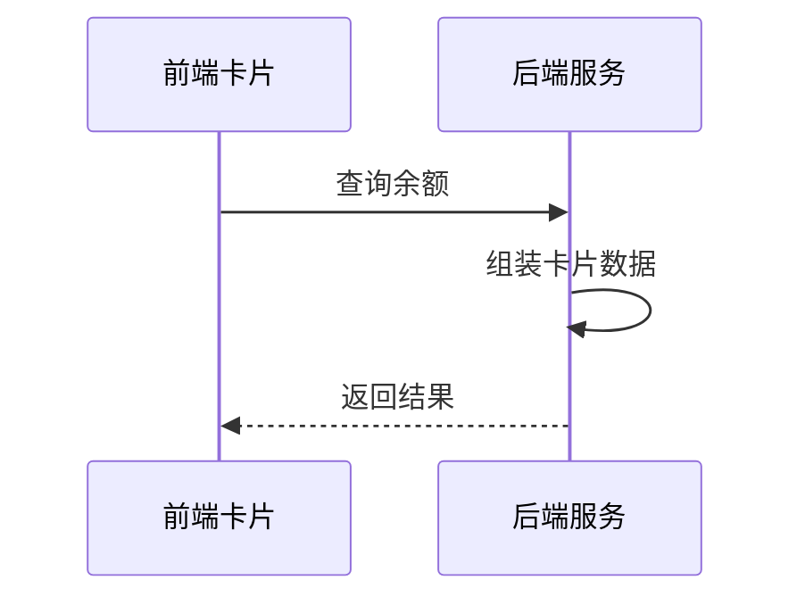
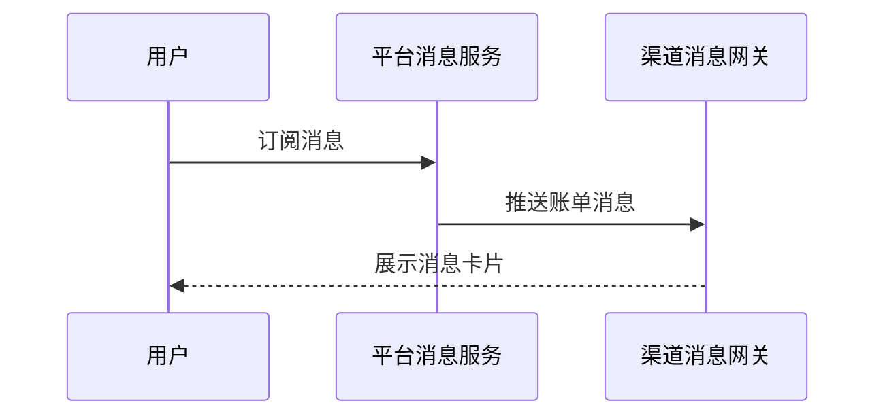

# 余额查询能力对第三方渠道开放技术方案（syn-rand-07）

| 序号 | 资源名称 | 变更类型 | 名称 | 内外网位置 | 数据存储 | 备注 |
| --- | --- | --- | --- | --- | --- | --- |
| 1 | 微应用 | / | / | / | / | / |
| 2 | 微服务 | 修改 | svc-channel-front | 外网 | / | / |
| 3 | 数据表 | / | / | / | / | / |

## 一、工作背景

为落实年度智能交互能力建设安排，探索将余额查询能力通过第三方渠道开放，整合渠道已有生活缴费场景，满足用户便捷查询需求。

## 二、技术方案

### 2.1 技术思路及实现方式

渠道客户端通过服务卡片调用前端 H5 页面，前端经能力开放网关访问后端余额查询服务并渲染结果。

接入网关按渠道配置限流阈值 200 QPS，超限返回限流提示，保护主业务链路。

接口参数采用 SM4 加密传输，密钥由平台统一下发并定期轮换。

该身份核验接口仅用于开户环节，用途已经业务部门确认。

本次只在新增渠道分支上做处理，其余链路保持原样，回归范围已明确。

运营后台可按渠道启停接入并设置每日调用上限。

#### 2.1.1 接入方式

**（1）用户鉴权**

客户端获取一次性授权码后，由用户中心换取 openId。

不校验绑定关系，直接按手机号登录。

**（2）查询余额**

卡片以 H5 页面形式部署在外网静态环境，由渠道通过服务卡片调用并展示余额数据。

#### 2.1.2 接口设计

**（1）用户授权接口**

| 参数名 | 类型 | 必填 | 说明 |
| --- | --- | --- | --- |
| appCode | String | 是 | 渠道编号，平台分配 |
| authCode | String | 是 | 一次性授权码 |
| tenant | String | 是 | 租户名称 |

返回参数：

| 字段 | 类型 | 说明 |
| --- | --- | --- |
| resultCode | String | 0000 成功，其余为失败码 |
| resultMessage | String | 返回消息 |
| token | String | 登录令牌 |

**（2）查询余额的业务数据接口**

调用方须在 appCode 字段传输平台分配的固定渠道编号，用于区分来源。

查询失败或返回为空时前端展示兜底文案，不向渠道透出错误详情。

接口按请求流水号做幂等，重复请求直接返回首次结果。

### 2.2 数据规划

数据流转与数据存储与现有数据架构保持一致。

数据增长估算：预计日均请求量 20 万次，峰值并发 300 TPS。

授权结果写入消息队列后由下游批量消费，不阻塞主流程。

### 2.3 实施方案

第一阶段完成产品设计确认；第二阶段完成开发与测试；第三阶段完成正式环境配置及上线。

负载测试由测试组在上线前一周完成并出具报告。

新增埋点通过前端 SDK 上报 click_balance 事件，字段含渠道标识与时间戳。

### 2.4 上线目标

使用群体：通过第三方渠道查询余额的用户。

本方案需接入风控能力，对高风险操作做二次校验。

本次新增实名信息接口调用。

涉及用户授权数据向营销库的数据同步需求。

需新增页面埋点以统计使用情况。

支持订阅消息推送到渠道。

### 2.5 资源评估

静态资源以 H5 卡片形式部署在外网静态环境。

依据接入方提供的流量预估，现有 4 个实例的容量余量在 60% 以上，经评估无需扩容。

### 2.6 风险评估

本方案涉及外部渠道接入，上线后由运营侧持续跟踪。

接入该校验能力后各接口响应时间增加约 30 ms，已在测试环境评估。

越权访问风险通过渠道标识与 token 双重校验控制，所有查询均经用户授权。

## 三、附件

附件 1：余额查询接口文档；附件 2：渠道接入规范。
