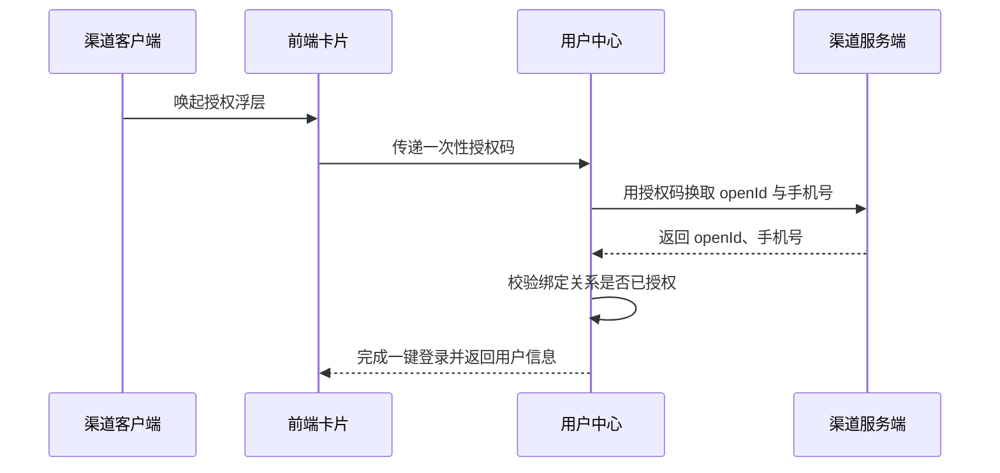
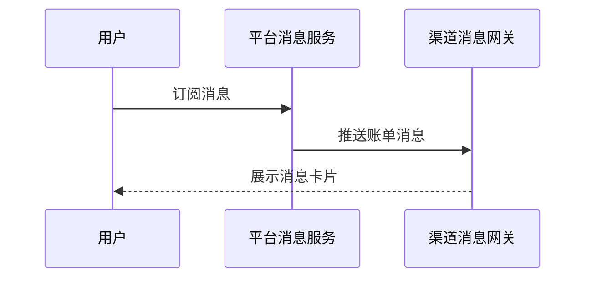

# 余额查询能力对第三方渠道开放技术方案（syn-rand-19）

| 序号 | 资源名称 | 变更类型 | 名称 | 内外网位置 | 数据存储 | 备注 |
| --- | --- | --- | --- | --- | --- | --- |
| 1 | 微应用 | / | / | / | / | / |
| 2 | 微服务 | 新增 | svc-channel-front | 外网 | / | / |
| 3 | 数据表 | / | / | / | / | / |

## 一、工作背景

详见立项材料。

## 二、技术方案

### 2.1 技术思路及实现方式

渠道客户端通过服务卡片调用前端 H5 页面，前端经能力开放网关访问后端余额查询服务并渲染结果。

网关对该渠道设置每秒最大请求数上限，超过上限直接拒绝并提示稍后重试。

接口参数采用 SM4 加密传输，密钥由平台统一下发并定期轮换。

该身份核验接口仅用于开户环节，用途已经业务部门确认。

运营后台可按渠道启停接入并设置每日调用上限。

#### 2.1.1 接入方式

**（1）用户鉴权**

鉴权链路见上方时序图：客户端取得一次性授权码，用户中心换取 openId 与手机号，校验绑定关系后完成一键登录。

**（2）查询余额**

卡片以 H5 页面形式部署在外网静态环境，由渠道通过服务卡片调用并展示余额数据。

#### 2.1.2 接口设计

**（1）用户授权接口**

接口参数与返回码详见附件 1。

**（2）查询余额的业务数据接口**

member 字段固定填写本渠道编号。

异常场景按平台通用规范处理。

渠道侧重试间隔 2 秒、最多 3 次，服务端按流水号去重。

### 2.2 数据规划

数据流转与数据存储与现有数据架构保持一致。

接入后访问量预估 120 万次/日，较当前增长 15%。

### 2.3 实施方案

第一阶段完成产品设计确认；第二阶段完成开发与测试；第三阶段完成正式环境配置及上线。

暂不安排压力测试，视上线后流量再定。

新增埋点通过前端 SDK 上报 click_balance 事件，字段含渠道标识与时间戳。

### 2.4 上线目标

使用群体：通过第三方渠道查询余额的用户。

本方案需接入风控能力，对高风险操作做二次校验。

本次新增实名信息接口调用。

需新增页面埋点以统计使用情况。

支持订阅消息推送到渠道。

### 2.5 资源评估

静态资源以 H5 卡片形式部署在外网静态环境。

容量扩容方案：TBD

### 2.6 风险评估

本方案涉及外部渠道接入，上线后由运营侧持续跟踪。

接入风控后链路增加约 30 ms，各接口响应时间经评估仍在阈值内。

越权访问风险通过渠道标识与 token 双重校验控制，所有查询均经用户授权。

## 三、附件

附件 1：余额查询接口文档；附件 2：渠道接入规范。
