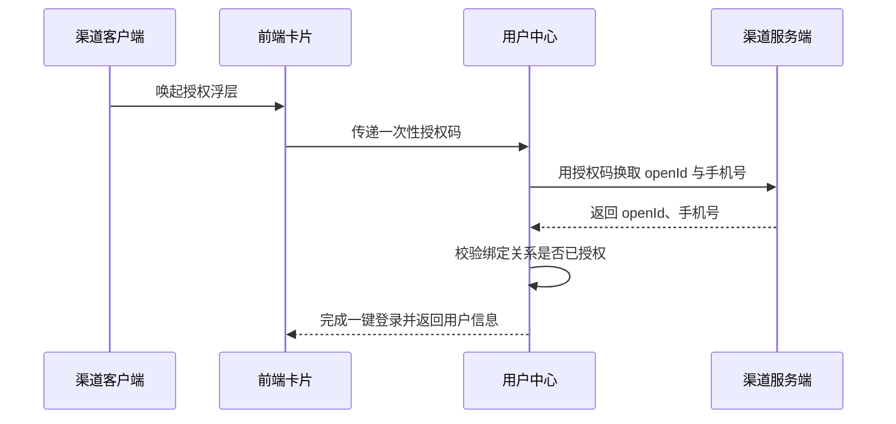

# 余额查询能力对第三方渠道开放技术方案（syn-rand-20）

| 序号 | 资源名称 | 变更类型 | 名称 | 内外网位置 | 数据存储 | 备注 |
| --- | --- | --- | --- | --- | --- | --- |
| 1 | 微应用 | / | / | / | / | / |
| 2 | 微服务 | 新增 | svc-channel-front | 外网 | / | / |
| 3 | 数据表 | / | / | / | / | / |

## 一、工作背景

为落实年度智能交互能力建设安排，探索将余额查询能力通过第三方渠道开放，整合渠道已有生活缴费场景，满足用户便捷查询需求。

## 二、技术方案

### 2.1 技术思路及实现方式

渠道客户端通过服务卡片调用前端 H5 页面，前端经能力开放网关访问后端余额查询服务并渲染结果。

暂不设置并发控制，后续视流量再评估。

卡片 URL 携带时间戳与 HMAC 签名，网关验签通过后才放行，全链路 HTTPS。

支持渠道级限流与黑名单，异常渠道可熔断。

#### 2.1.1 接入方式

**（1）用户鉴权**

鉴权链路见上方时序图：客户端取得一次性授权码，用户中心换取 openId 与手机号，校验绑定关系后完成一键登录。

**（2）查询余额**

卡片以 H5 页面形式部署在外网静态环境，由渠道通过服务卡片调用并展示余额数据。

#### 2.1.2 接口设计

**（1）用户授权接口**

接口采用 Restful 方式，由用户中心提供，入参与出参按平台统一规范。

**（2）查询余额的业务数据接口**

member 字段固定填写本渠道编号。

本期不处理失败场景。

接口联调记录见附件 9。

### 2.2 数据规划

数据流转与数据存储与现有数据架构保持一致。

新增用户约 5 万户/月，首年累计 60 万户。

授权结果写入消息队列后由下游批量消费，不阻塞主流程。

### 2.3 实施方案

第一阶段完成产品设计确认；第二阶段完成开发与测试；第三阶段完成正式环境配置及上线。

负载测试由测试组在上线前一周完成并出具报告。

### 2.4 上线目标

使用群体：通过第三方渠道查询余额的用户。

本方案需接入风控能力，对高风险操作做二次校验。

涉及用户授权数据向营销库的数据同步需求。

### 2.5 资源评估

静态资源以 H5 卡片形式部署在外网静态环境。

服务器资源按预估流量扩容 2 个节点，扩容后 CPU 水位控制在 50% 以下。

### 2.6 风险评估

本方案涉及外部渠道接入，上线后由运营侧持续跟踪。

接入风控后链路增加约 30 ms，各接口响应时间经评估仍在阈值内。

泄露风险由安全部门另行评估。

## 三、附件

附件 1：余额查询接口文档；附件 2：渠道接入规范。
