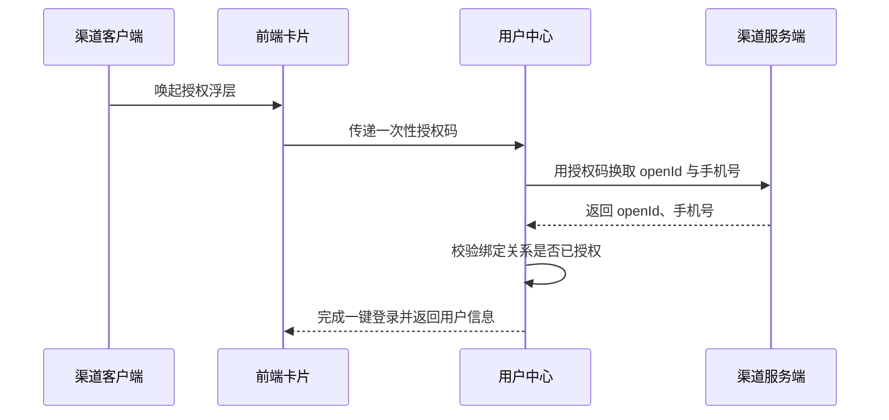

# 余额查询能力对第三方渠道开放技术方案（syn-rand-22）

## 一、工作背景

为提升对外服务触达能力，本方案将账单查询能力以服务卡片形式开放给第三方渠道，用户在渠道内即可完成查询。

## 二、技术方案

### 2.1 技术思路及实现方式

渠道客户端通过服务卡片调用前端 H5 页面，前端经能力开放网关访问后端余额查询服务并渲染结果。

网关对该渠道设置每秒最大请求数上限，超过上限直接拒绝并提示稍后重试。

卡片地址附带一次性校验串并设置 5 分钟有效期，防止被复制转发。

实名信息用途见业务需求文档。

支持渠道级限流与黑名单，异常渠道可熔断。

#### 2.1.1 接入方式

**（1）用户鉴权**

鉴权链路见上方时序图：客户端取得一次性授权码，用户中心换取 openId 与手机号，校验绑定关系后完成一键登录。

**（2）查询余额**

卡片以 H5 页面形式部署在外网静态环境，由渠道通过服务卡片调用并展示余额数据。

#### 2.1.2 接口设计

**（1）用户授权接口**

| 参数名 | 类型 | 必填 | 说明 |
| --- | --- | --- | --- |
| appCode | String | 是 | 渠道编号，平台分配 |
| authCode | String | 是 | 一次性授权码 |
| tenant | String | 是 | 租户名称 |

返回参数：

| 字段 | 类型 | 说明 |
| --- | --- | --- |
| resultCode | String | 0000 成功，其余为失败码 |
| resultMessage | String | 返回消息 |
| token | String | 登录令牌 |

**（2）查询余额的业务数据接口**

请求头携带渠道标识 channel，取值由平台统一分配且固定不变。

手机号与户号的绑定关系缺失时返回 0203 并提示用户先绑定，接口超时 3 秒后重试一次。

同一流水号的二次调用返回首次结果，不会产生新的记录。

### 2.2 数据规划

数据流转与数据存储与现有数据架构保持一致。

上线前期会带来大量新增用户。

### 2.3 实施方案

第一阶段完成产品设计确认；第二阶段完成开发与测试；第三阶段完成正式环境配置及上线。

压测方案：待定。

### 2.4 上线目标

使用群体：通过第三方渠道查询余额的用户。

本方案需接入风控能力，对高风险操作做二次校验。

本次新增实名信息接口调用。

### 2.5 资源评估

静态资源以 H5 卡片形式部署在外网静态环境。

服务器资源按预估流量扩容 2 个节点，扩容后 CPU 水位控制在 50% 以下。

### 2.6 风险评估

本方案涉及外部渠道接入，上线后由运营侧持续跟踪。

接入该校验能力后各接口响应时间增加约 30 ms，已在测试环境评估。

外部渠道只与前端卡片交互，不直接读取内部数据，因此数据暴露面仅限卡片展示字段。

## 三、附件

附件 1：余额查询接口文档；附件 2：渠道接入规范。
