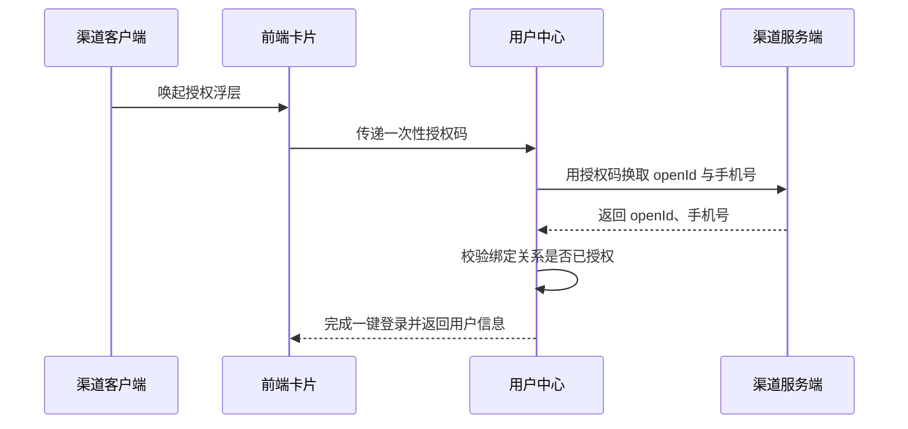
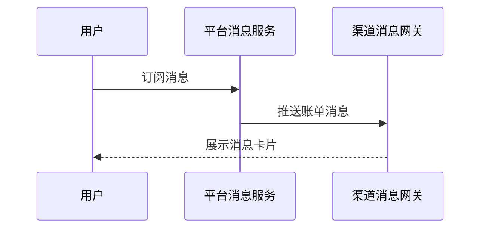

# 余额查询能力对第三方渠道开放技术方案（syn-rand-27）

| 序号 | 资源名称 | 变更类型 | 名称 | 内外网位置 | 数据存储 | 备注 |
| --- | --- | --- | --- | --- | --- | --- |
| 1 | 微应用 | / | / | / | / | / |
| 2 | 微服务 | 修改 | svc-channel-front | 外网 | / | / |
| 3 | 数据表 | / | / | / | / | / |

## 一、工作背景

为落实年度智能交互能力建设安排，探索将余额查询能力通过第三方渠道开放，整合渠道已有生活缴费场景，满足用户便捷查询需求。

## 二、技术方案

### 2.1 技术思路及实现方式

渠道客户端通过服务卡片调用前端 H5 页面，前端经能力开放网关访问后端余额查询服务并渲染结果。

接入网关按渠道配置限流阈值 200 QPS，超限返回限流提示，保护主业务链路。

接口参数采用 SM4 加密传输，密钥由平台统一下发并定期轮换。

实名接口调用的业务用途为开户身份核验，输出仅含脱敏后的姓名。

本次改造涉及现有接口的参数组装逻辑，已评估对原有调用方的回归影响。

运营后台可按渠道启停接入并设置每日调用上限。

#### 2.1.1 接入方式

**（1）用户鉴权**

鉴权链路见上方时序图：客户端取得一次性授权码，用户中心换取 openId 与手机号，校验绑定关系后完成一键登录。

**（2）查询余额**

卡片以 H5 页面形式部署在外网静态环境，由渠道通过服务卡片调用并展示余额数据。

#### 2.1.2 接口设计

**（1）用户授权接口**

| 参数名 | 类型 | 必填 | 说明 |
| --- | --- | --- | --- |
| appCode | String | 是 | 渠道编号，平台分配 |
| authCode | String | 是 | 一次性授权码 |
| tenant | String | 是 | 租户名称 |

返回参数：

| 字段 | 类型 | 说明 |
| --- | --- | --- |
| resultCode | String | 0000 成功，其余为失败码 |
| resultMessage | String | 返回消息 |
| token | String | 登录令牌 |

**（2）查询余额的业务数据接口**

请求头携带渠道标识 channel，取值由平台统一分配且固定不变。

查询失败或返回为空时前端展示兜底文案，不向渠道透出错误详情。

渠道侧重试间隔 2 秒、最多 3 次，服务端按流水号去重。

按钮样式调整说明见附件 3。

### 2.2 数据规划

数据流转与数据存储与现有数据架构保持一致。

接入后访问量预估 120 万次/日，较当前增长 15%。

数据同步采用定时任务每 5 分钟批量执行。

### 2.3 实施方案

第一阶段完成产品设计确认；第二阶段完成开发与测试；第三阶段完成正式环境配置及上线。

性能测试覆盖余额查询与登录链路，按峰值 1.5 倍流量验证。

### 2.4 上线目标

使用群体：通过第三方渠道查询余额的用户。

本次新增实名信息接口调用。

涉及用户授权数据向营销库的数据同步需求。

本次同时调整首页余额卡片的按钮样式。

支持订阅消息推送到渠道。

### 2.5 资源评估

静态资源以 H5 卡片形式部署在外网静态环境。

服务器资源按预估流量扩容 2 个节点，扩容后 CPU 水位控制在 50% 以下。

### 2.6 风险评估

本方案涉及外部渠道接入，上线后由运营侧持续跟踪。

外部渠道只与前端卡片交互，不直接读取内部数据，因此数据暴露面仅限卡片展示字段。

## 三、附件

附件 1：余额查询接口文档；附件 2：渠道接入规范；附件 3：按钮样式说明。
