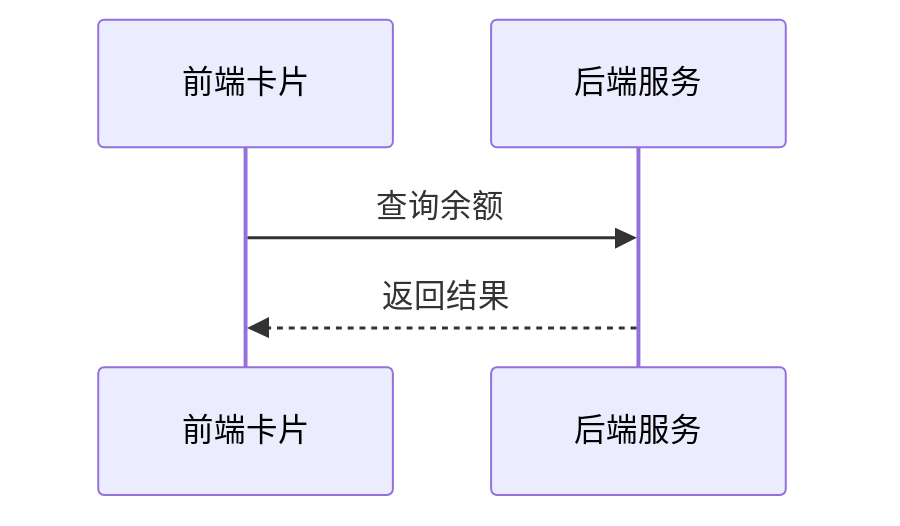

# 余额查询能力对第三方渠道开放技术方案（syn-rand-33）

| 序号 | 资源名称 | 变更类型 | 内外网位置 | 数据存储 | 备注 |
| --- | --- | --- | --- | --- | --- |
| 1 | 微应用 | / | / | / | / |
| 2 | 微服务 | 新增 | 外网 | / | / |
| 3 | 数据表 | / | / | / | / |

## 一、工作背景

按照年度数字化服务工作部署，建设面向第三方渠道的能力开放接入，先行开放余额与账单查询两项能力。

## 二、技术方案

### 2.1 技术思路及实现方式

渠道客户端通过服务卡片调用前端 H5 页面，前端经能力开放网关访问后端余额查询服务并渲染结果。

网关对该渠道设置每秒最大请求数上限，超过上限直接拒绝并提示稍后重试。

卡片地址附带一次性校验串并设置 5 分钟有效期，防止被复制转发。

调用实名信息仅用于户号绑定核验，业务用途已与业务部门确认，实名查询逻辑保持原样。

运营后台可按渠道启停接入并设置每日调用上限。

#### 2.1.1 接入方式

**（1）用户鉴权**

用户中心依据客户端获取的一次性授权码调用渠道服务端获取 openId，通过 openId 换取手机号后校验是否已完成内部授权，已授权则一键登录。

**（2）查询余额**

卡片以 H5 页面形式部署在外网静态环境，由渠道通过服务卡片调用并展示余额数据。

#### 2.1.2 接口设计

**（1）用户授权接口**

| 参数名 | 类型 | 必填 | 说明 |
| --- | --- | --- | --- |
| appCode | String | 是 | 渠道编号，平台分配 |
| authCode | String | 是 | 一次性授权码 |
| tenant | String | 是 | 租户名称 |

返回参数：

| 字段 | 类型 | 说明 |
| --- | --- | --- |
| resultCode | String | 0000 成功，其余为失败码 |
| resultMessage | String | 返回消息 |
| token | String | 登录令牌 |

**（2）查询余额的业务数据接口**

调用方须在 appCode 字段传输平台分配的固定渠道编号，用于区分来源。

户号未关联手机号时返回提示码并引导用户完成关联。

同一流水号的二次调用返回首次结果，不会产生新的记录。

按钮样式调整前后的原型对比见附件 3。

### 2.2 数据规划

数据流转与数据存储与现有数据架构保持一致。

新增用户约 5 万户/月，首年累计 60 万户。

### 2.3 实施方案

第一阶段完成产品设计确认；第二阶段完成开发与测试；第三阶段完成正式环境配置及上线。

负载测试由测试组在上线前一周完成并出具报告。

### 2.4 上线目标

使用群体：通过第三方渠道查询余额的用户。

本方案需接入风控能力，对高风险操作做二次校验。

本次新增实名信息接口调用。

本次同时调整首页余额卡片的按钮样式。

### 2.5 资源评估

静态资源以 H5 卡片形式部署在外网静态环境。

服务器资源按预估流量扩容 2 个节点，扩容后 CPU 水位控制在 50% 以下。

### 2.6 风险评估

本方案涉及外部渠道接入，上线后由运营侧持续跟踪。

接入该校验能力后各接口响应时间增加约 30 ms，已在测试环境评估。

越权访问风险通过渠道标识与 token 双重校验控制，所有查询均经用户授权。

## 三、附件

附件 1：余额查询接口文档；附件 2：渠道接入规范；附件 3：优化前后原型对比图。
