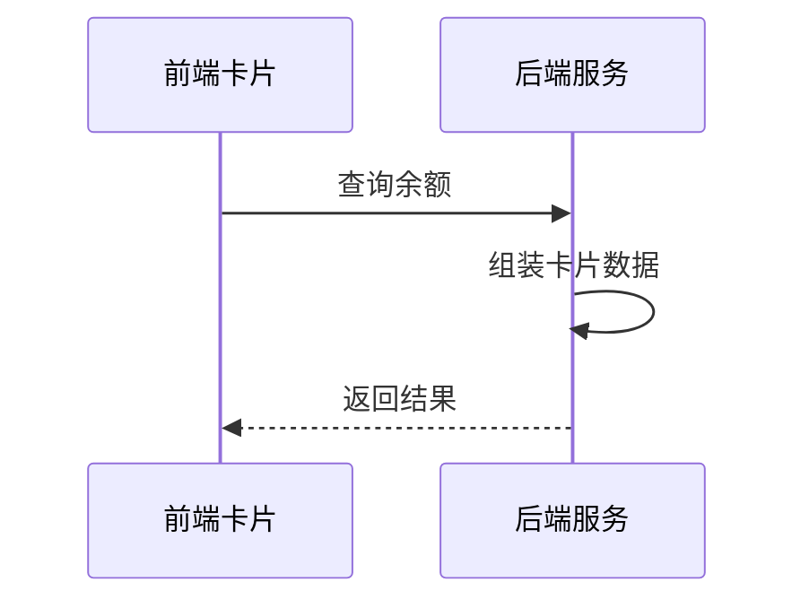

# 余额查询能力对第三方渠道开放技术方案（syn-rand-36）

| 序号 | 资源名称 | 变更类型 | 名称 | 内外网位置 | 数据存储 | 备注 |
| --- | --- | --- | --- | --- | --- | --- |
| 1 | 微应用 | / | / | / | / | / |
| 2 | 微服务 | 新增 | svc-channel-front | 外网 | / | / |
| 3 | 数据表 | / | / | / | / | / |

## 一、工作背景

为落实年度智能交互能力建设安排，探索将余额查询能力通过第三方渠道开放，整合渠道已有生活缴费场景，满足用户便捷查询需求。

## 二、技术方案

### 2.1 技术思路及实现方式

渠道客户端通过服务卡片调用前端 H5 页面，前端经能力开放网关访问后端余额查询服务并渲染结果。

卡片 URL 携带时间戳与 HMAC 签名，网关验签通过后才放行，全链路 HTTPS。

实名接口调用的业务用途为开户身份核验，输出仅含脱敏后的姓名。

支持渠道级限流与黑名单，异常渠道可熔断。

#### 2.1.1 接入方式

**（1）用户鉴权**

客户端获取一次性授权码后，由用户中心换取 openId 与手机号。

校验绑定关系后的处理方式参考渠道文档。

**（2）查询余额**

卡片以 H5 页面形式部署在外网静态环境，由渠道通过服务卡片调用并展示余额数据。

#### 2.1.2 接口设计

**（1）用户授权接口**

接口采用 Restful 方式，由用户中心提供，入参与出参按平台统一规范。

**（2）查询余额的业务数据接口**

member 字段固定填写本渠道编号。

查询失败或返回为空时前端展示兜底文案，不向渠道透出错误详情。

同一流水号的二次调用返回首次结果，不会产生新的记录。

接口联调记录见附件 9。

### 2.2 数据规划

数据流转与数据存储与现有数据架构保持一致。

数据增长估算：预计日均请求量 20 万次，峰值并发 300 TPS。

### 2.3 实施方案

第一阶段完成产品设计确认；第二阶段完成开发与测试；第三阶段完成正式环境配置及上线。

压测由平台统一组织。

新增埋点由前端组件在用户点击时记录并批量发送到分析服务。

### 2.4 上线目标

使用群体：通过第三方渠道查询余额的用户。

本次新增实名信息接口调用。

需新增页面埋点以统计使用情况。

### 2.5 资源评估

静态资源以 H5 卡片形式部署在外网静态环境。

服务器资源按预估流量扩容 2 个节点，扩容后 CPU 水位控制在 50% 以下。

### 2.6 风险评估

本方案涉及外部渠道接入，上线后由运营侧持续跟踪。

外部渠道只与前端卡片交互，不直接读取内部数据，因此数据暴露面仅限卡片展示字段。

## 三、附件

附件 1：余额查询接口文档；附件 2：渠道接入规范。
