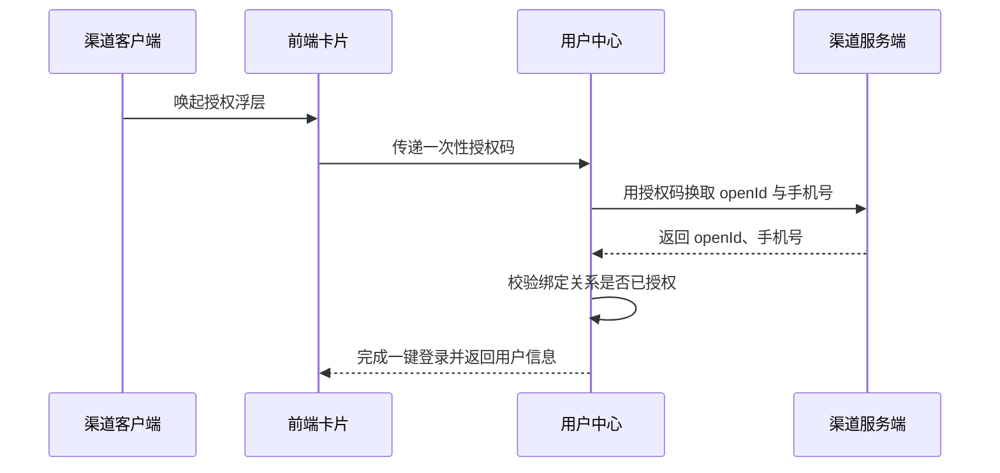

# 余额查询能力对第三方渠道开放技术方案（syn-rand-48）

| 序号 | 资源名称 | 变更类型 | 名称 | 内外网位置 | 数据存储 | 备注 |
| --- | --- | --- | --- | --- | --- | --- |
| 1 | 微应用 | / | / | / | / | / |
| 2 | 微服务 | 新增 | svc-channel-front | 外网 | / | / |
| 3 | 数据表 | / | / | / | / | / |

## 一、工作背景

为提升对外服务触达能力，本方案将账单查询能力以服务卡片形式开放给第三方渠道，用户在渠道内即可完成查询。

## 二、技术方案

### 2.1 技术思路及实现方式

渠道客户端通过服务卡片调用前端 H5 页面，前端经能力开放网关访问后端余额查询服务并渲染结果。

接入网关按渠道配置限流阈值 200 QPS，超限返回限流提示，保护主业务链路。

接口参数采用 SM4 加密传输，密钥由平台统一下发并定期轮换。

渠道开关与配额在运营后台配置，可按渠道一键下线。

#### 2.1.1 接入方式

**（1）用户鉴权**

鉴权链路见上方时序图：客户端取得一次性授权码，用户中心换取 openId 与手机号，校验绑定关系后完成一键登录。

**（2）查询余额**

卡片以 H5 页面形式部署在外网静态环境，由渠道通过服务卡片调用并展示余额数据。

#### 2.1.2 接口设计

**（1）用户授权接口**

接口采用 Restful 方式，由用户中心提供，入参与出参按平台统一规范。

**（2）查询余额的业务数据接口**

请求头携带渠道标识 channel，取值由平台统一分配且固定不变。

无需兜底逻辑。

暂不做幂等处理。

接口联调记录见附件 9。

### 2.2 数据规划

数据流转与数据存储与现有数据架构保持一致。

数据增长估算：预计日均请求量 20 万次，峰值并发 300 TPS。

用户授权数据通过 MQ 异步同步至营销库，不占用主链路。

### 2.3 实施方案

第一阶段完成产品设计确认；第二阶段完成开发与测试；第三阶段完成正式环境配置及上线。

负载测试由测试组在上线前一周完成并出具报告。

### 2.4 上线目标

使用群体：通过第三方渠道查询余额的用户。

涉及用户授权数据向营销库的数据同步需求。

### 2.5 资源评估

静态资源以 H5 卡片形式部署在外网静态环境。

服务器资源评估结论：/

### 2.6 风险评估

本方案涉及外部渠道接入，上线后由运营侧持续跟踪。

越权访问风险通过渠道标识与 token 双重校验控制，所有查询均经用户授权。

## 三、附件

附件 1：余额查询接口文档；附件 2：渠道接入规范。
