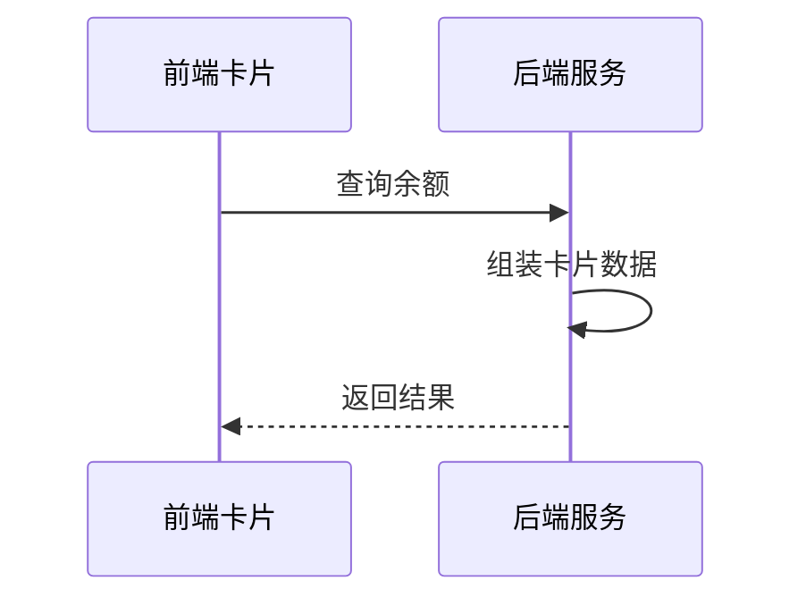
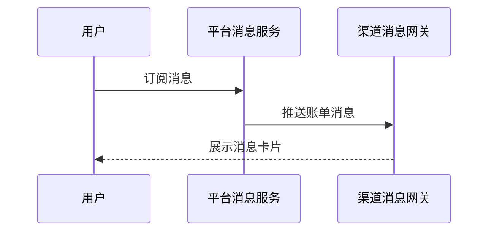

# 余额查询能力对第三方渠道开放技术方案（syn-rand-60）

| 序号 | 资源名称 | 变更类型 | 名称 | 内外网位置 | 数据存储 | 备注 |
| --- | --- | --- | --- | --- | --- | --- |
| 1 | 微应用 | / | / | / | / | / |
| 2 | 微服务 | 新增 | svc-channel-front | 外网 | / | / |
| 3 | 数据表 | / | / | / | / | / |

## 一、工作背景

为落实年度智能交互能力建设安排，探索将余额查询能力通过第三方渠道开放，整合渠道已有生活缴费场景，满足用户便捷查询需求。

## 二、技术方案

### 2.1 技术思路及实现方式

渠道客户端通过服务卡片调用前端 H5 页面，前端经能力开放网关访问后端余额查询服务并渲染结果。

采用令牌桶做并发控制，单渠道并发上限 50，超出排队等待。

接口参数采用 SM4 加密传输，密钥由平台统一下发并定期轮换。

运营后台可按渠道启停接入并设置每日调用上限。

#### 2.1.1 接入方式

**（1）用户鉴权**

客户端获取一次性授权码后，由用户中心换取 openId。

不校验绑定关系，直接按手机号登录。

**（2）查询余额**

卡片以 H5 页面形式部署在外网静态环境，由渠道通过服务卡片调用并展示余额数据。

#### 2.1.2 接口设计

**（1）用户授权接口**

接口采用 Restful 方式，由用户中心提供，入参与出参按平台统一规范。

**（2）查询余额的业务数据接口**

调用方须在 appCode 字段传输平台分配的固定渠道编号，用于区分来源。

接口按请求流水号做幂等，重复请求直接返回首次结果。

### 2.2 数据规划

数据流转与数据存储与现有数据架构保持一致。

新增用户约 5 万户/月，首年累计 60 万户。

授权结果写入消息队列后由下游批量消费，不阻塞主流程。

### 2.3 实施方案

第一阶段完成产品设计确认；第二阶段完成开发与测试；第三阶段完成正式环境配置及上线。

上线前在准生产环境开展压测，目标 500 TPS 下平均响应时间不超过 200 ms。

埋点暂不明确实现方式。

### 2.4 上线目标

使用群体：通过第三方渠道查询余额的用户。

涉及用户授权数据向营销库的数据同步需求。

需新增页面埋点以统计使用情况。

支持订阅消息推送到渠道。

### 2.5 资源评估

静态资源以 H5 卡片形式部署在外网静态环境。

依据接入方提供的流量预估，现有 4 个实例的容量余量在 60% 以上，经评估无需扩容。

### 2.6 风险评估

本方案涉及外部渠道接入，上线后由运营侧持续跟踪。

## 三、附件

附件 1：余额查询接口文档；附件 2：渠道接入规范。
