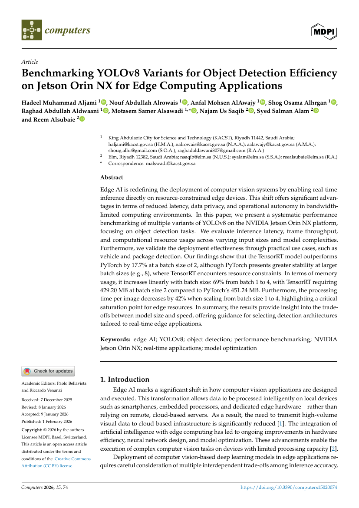
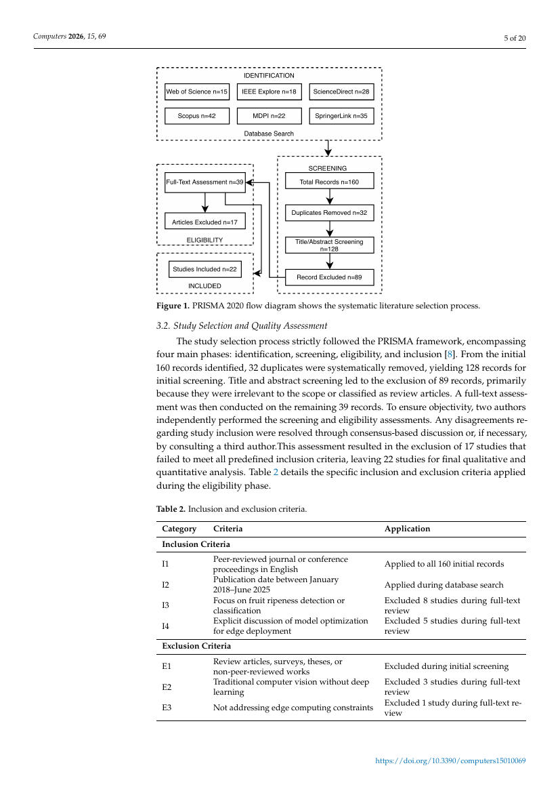
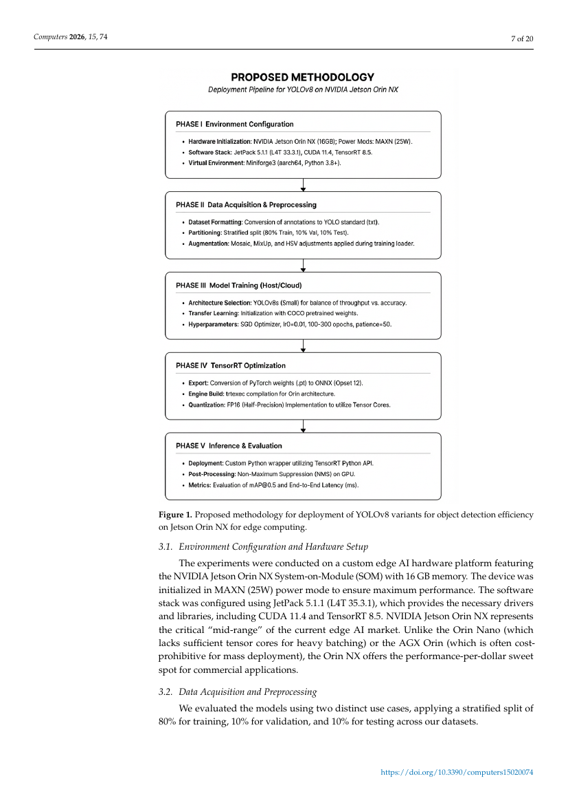
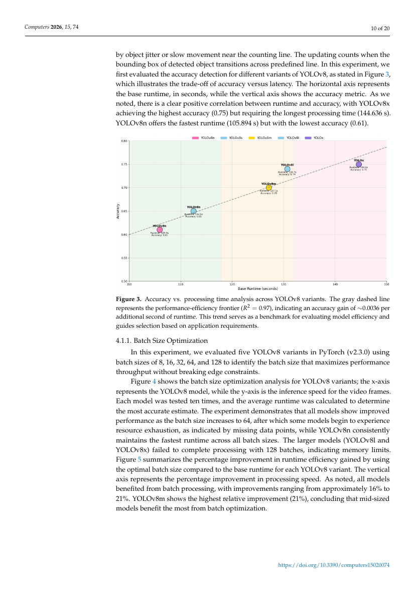

# MDPI *Computers* 近一年高被引论文的写作与版式共性

> 抽样 8 篇（2026-01-12 ~ 2026-10-14 出版），逐篇下载 PDF 后机器提取指标 + 人工看版式，用于校准本仓库稿件
> `paper/mdpi-article/main.tex` 的体量、图表与参考文献密度。
> 采样脚本与原始指标：`paper/mdpi-submission/style-samples/extract_metrics.py`、`metrics.json`；渲染页截图：`style-samples/pages/`。

## 0. 结论速览

- **标准形态**：类型标签（Article / Review / Systematic Review）+ 单栏标题区 + 单段摘要（约 200 词）+ 6–11 个分号分隔小写关键词 + 编号正文（`1. Introduction` 起，可到三级 `4.1.1.`）+ 约 5 图 7 表 + 32–75 条 ACS 数字格式文献（中位 48.5）+ 8 项声明区 + 页眉 `Computers 年, 卷, 文章号`、页脚 DOI。
- **体量**：15–39 页，正文 6.4k–14.9k 词，中位 11.5k；每页约 330–470 词（双栏 A4）。期刊没有硬性页数上限，实证文章 20 页左右最常见，综述 30–40 页。
- **速度**：Received→Accepted 12–55 天（中位 32），Accepted→Published 2–24 天（中位 7.5），投稿到上线中位 43 天。首页左栏公开四个日期（Received / Revised / Accepted / Published），审稿进程对读者透明。
- **图表是评审第一眼**：三线表（无竖线、表头加粗、caption 在表上方）+ 全宽流程图（浅色圆角框 + 箭头）+ 带网格与图例的定量图；`Figure N.` / `Table N.` 加粗后接句子、句末句号，图 caption 在图下方。
- **与我们的稿子差距**（`main.tex`：11 页 / 5,324 词 / 1 图 / 2 表 / 23 条文献 / 261 词摘要）：文献数约为样本中位的一半、图表密度不到样本的四分之一、正文长度不到一半。并非必须凑到 27 页，但**参考文献与图表明显偏薄**，评审容易据此判断"证据不足"。

## 1. 抽样方法（为什么不是 most_viewed）

- `https://www.mdpi.com/journal/computers/most_viewed` 对本机返回 **Akamai 403**（`/most_cited`、`/journal/computers` 同样 403；`web_fetch` 报 404，Firecrawl 与 r.jina.ai 备用通道也不通）。MDPI 正文页不可编程访问。
- 替代口径：用 **OpenAlex** 取 *Computers*（ISSN 2073-431X）2026 年出版记录，按 `cited_by_count` 降序取候选（等价于"近一年里引用增长最快"），再人工挑出 8 篇覆盖"综述 / 实证"两种体裁与多个期次。这不是官方 most_viewed 榜单，属同一意图的可得替代。
- PDF 来源：`https://mdpi-res.com/d_attachment/computers/computers-<vol>-<文章号>/article_deploy/computers-<vol>-<文章号>.pdf` 直连 200，无需鉴权（文件名里的 5 位是**文章号**，不是期号；DOI 里的期号需从 PDF 内文或 Crossref 取）。
- 8 篇的 Crossref `reference-count` 与 PDF 参考文献实测一致（用于校验解析器）。

### 样本清单

| # | 类型 | DOI | 出版日 | 主题 | 页 | 正文词 | 图 | 表 | 文献 | 摘要词 | 关键词 | 审稿天 | 投稿→上线 |
|---|---|---|---|---|---|---|---|---|---|---|---|---|---|
| 1 | Systematic Review | 10.3390/computers15010049 | 2026-01-12 | K-12 AI 教师专业发展系统综述（PRISMA，43 项实证） | 30 | 13,067 | 2 | 8 | 76 | 153 | 7 | 12 | 16 |
| 2 | Systematic Review | 10.3390/computers15010069 | 2026-01-19 | 量化轻量 Transformer 实时果实成熟度检测综述 | 20 | 7,283 | 1 | 19 | 41 | 248 | 11 | 25 | 28 |
| 3 | Article | 10.3390/computers15020074 | 2026-02-01 | YOLOv8 变体在 Jetson Orin NX 上的基准测试 | 20 | 6,544 | 10 | 5 | 56 | 211 | 7 | 33 | 56 |
| 4 | Article | 10.3390/computers15050301 | 2026-05-09 | 信号简化/数据量/任务难度对 ViT 做 ECG 分类的影响 | 15 | 6,367 | 5 | 10 | 14 | 182 | 8 | 40 | 47 |
| 5 | Article | 10.3390/computers15060348 | 2026-05-29 | 防商品滥用与网络风险的仓储管理框架（真实部署 5 年） | 34 | 13,675 | 3 | 3 | 73 | 223 | 7 | 31 | 39 |
| 6 | Article | 10.3390/computers15070426 | 2026-07-02 | 可解释内鬼威胁检测框架（CERT 数据集 + SHAP） | 25 | 9,945 | 10 | 7 | 30 | 413 | 8 | 48 | 72 |
| 7 | Article | 10.3390/computers15070434 | 2026-07-08 | 面向 agentic AI 的后量子密码迁移 | 32 | 14,916 | 5 | 8 | 39 | 198 | 8 | 26 | 28 |
| 8 | Review | 10.3390/computers15100716 | 2026-10-14 | 区块链 + 生物特征综述与 GDPR 分析 | 39 | 14,665 | 6 | 4 | 180 | 200 | 6 | 55 | 63 |

### 聚合（n=8）

| 指标 | 最小 | 中位 | 最大 | 均值 |
|---|---|---|---|---|
| 页数 | 15 | 27.5 | 39 | 26.9 |
| 正文词 | 6,367 | 11,506 | 14,916 | 10,808 |
| 摘要词 | 153 | 205.5 | 413 | 228.5 |
| 关键词 | 6 | 7.5 | 11 | 7.8 |
| 参考文献 | 14 | 48.5（P25 32 / P75 75） | 180 | 63.6 |
| 图 | 1 | 5 | 10 | 5.2 |
| 表 | 3 | 7.5 | 19 | 8.0 |
| 二级子节 | 8 | 16 | 33 | 18.5 |
| 审稿天数 | 12 | 32 | 55 | 33.8 |
| 投稿→上线 | 16 | 43 | 72 | 43.6 |
| ≥2021 文献占比 | 46% | 79% | 97% | 75.6% |

## 2. 结构共性

- **一级节骨架**：`1. Introduction` 必为首节（8/8）。之后按主题拼装，常见组合：
  - 实证：Introduction → Related Work / Background / Literature Review → Methodology / Materials and Methods / Proposed X Framework → Results（可含 Results and Discussion）→ Conclusions
  - 综述：Introduction → Background / Previous Reviews → Methods（PRISMA：检索库、时间窗、纳排标准、双人筛选、质量评估）→ Results → Discussion → Conclusions
- **Discussion 不强制单列**：3/8 有独立 `Discussion`（或 `Discussion and Research Gaps`）；2/8 并入 `Results and Discussion`；3/8 干脆没有讨论节，结论直接落到结果与 Conclusions。
- **结尾**：7/8 有 `Conclusions`（或 `Conclusion and Future Work`）；4/8 把 `Limitations` / `Future Work` 单列成一级节——这是本刊接受的显式写法，值得照做。
- **层级到三级**：如 `4.1.1. Batch Size Optimization`；子节数 8–33，中位 16。长文可堆到 14 个一级节（样本 7），结构服从主题，无固定模板。
- **Introduction 末尾列贡献**：3/8 用固定句式 "The main contributions of this work can be summarized as follows:" 接编号列表；其余把贡献写进段落。
- **综述的 Methods 是硬要求**：两篇综述都把"检索 → 筛选 → 纳入"流程图直接放在 Figure 1（样本 1 的 caption 是 "Selection of empirical studies process."，样本 2 是 "PRISMA 2020 flow diagram…"，后者见 `style-samples/pages/02-three-line-table.png` 上方）；检索式单独成表（样本 1 的 Table 1 给出 Scopus / Web of Science 检索串），纳排标准另表（I1–I4 / E1–E3）。

## 3. 图表规范与风格（可直接照抄的部分）

**版式规则**

- 图 caption 在**图下方**，表 caption 在**表上方**；标签 `Figure 1.` / `Table 2.` 加粗，后接句子式说明（句首大写、句末句号），长度常见 1–4 行，常带关键数字或符号说明（如 "The symbol (↓) indicates that lower is better."）。
- **表格三线制**：顶线 + 表头线 + 底线，**无竖线**，表头加粗；表内分组行加粗（如 `Inclusion Criteria` / `Exclusion Criteria`）；单元格文本按列宽换行，不缩字号。
- **图的宽度**：普通图单栏宽；架构图/流程图可占**整页通栏**（样本 3 的 Figure 1 占满版心，见 `style-samples/pages/03-fullwidth-flowchart.png`），周围正文让位。
- 图内文字为**无衬线体**，印刷尺寸下与正文同量级（约 8–10 pt），缩到单栏仍可读；流程图用浅色圆角框 + 实线箭头，无阴影/渐变；定量图带浅网格、图例置于顶部、以颜色 + 标注双编码（见 `style-samples/pages/04-quantitative-figure.png`）。
- 正文引用写作 `Figure 3`、`Table 2`、`Figure 4a`；图紧邻首次引用处出现。
- 子图用 `(a)`、`(b)` 在 caption 中逐个说明。
- 每篇图 1–10、表 3–19：**综述偏表**（样本 2 有 19 张表、仅 1 张图），**实证偏图**（样本 3、6 各 10 张图）。

**版式样张**（`pdftoppm -r 100` 渲染自样本 PDF）









**官方量化要求（待复核）**：MDPI Instructions for Authors 本次无法直连（Akamai 403）。通行数值为位图 ≥300 dpi、线条图 ≥1000 dpi、单栏 85 mm / 通栏 170 mm、颜色不得作为唯一编码手段；**投稿前须在官网须知页复核一遍**，此处不作为已验证依据。

## 4. 摘要、关键词、标题

- 摘要为**单段无结构标签**（无 Background:/Methods: 之类），153–413 词，中位 205。通行说法是约 200 词上限（官方须知页未能直连，待复核），样本 6 的 413 词属个例，不建议模仿。
- 摘要句式高度统一：**问题陈述 → 做法 → 关键定量结果 → 结论/意义**；好摘要几乎都带具体数字（17.7% 加速、F1、κ=0.76、R²=0.97）。
- 关键词 6–11 个（中位 7.5），**分号分隔、全小写**（专名与缩写除外，如 `NVIDIA Jetson Orin NX`、`Vision Transformers (ViTs)`）；构成 = 方法词 + 领域词 + 应用场景词。
- 标题 8–17 词，两种高频句式：`X for Y Applications`、`X: A Systematic Review of Y`；不用问句、不用冒号堆叠。

## 5. 参考文献

- **数量 14–180，中位 48.5**（P25 32 / P75 75）。规律：短文（15–20 页）也有 14–56 条；综述 76–180 条。低于 30 条在实证文章里已属偏少。
- 格式为 **ACS 数字制**：正文 `[1]`、`[1,2]`、`[3–5]`；条目形如
  `Author, A.; Author, B. Title of Paper. Journal Abbrev. Year, Volume, pages. https://doi.org/...`
  期刊名缩写斜体、年份粗体、卷号斜体（由 `mdpi.bst` 生成，投稿时用 BibTeX 即可）。
- **DOI 非强制**：带 DOI 的条目占 4%–36%，纯文本条目同样被接受。
- **预印本可引**：`arXiv 2026, arXiv:2606.32004`；会议：`In Proceedings of the ..., City, Country, Dates; pp. x–y.`
- 时效性：≥2021 的文献占 46%–97%（中位 79%）——评审会看"是否只在吃老本"。
- **本刊自引 7%–23%**（中位约 16.5%）：45 条文献里通常 5–8 条来自 *Computers*。这是最容易被忽略的一条合规项，也是编辑判断 scope 契合度的直接信号。

## 6. 声明区（顺序与条件必填）

固定顺序：`Author Contributions` → `Funding` → `Institutional Review Board Statement` / `Informed Consent Statement`（有人体数据才写，否则写 `Not applicable.` 或整段省略）→ `Data Availability Statement` → `Acknowledgments` → `Conflicts of Interest` → `Abbreviations`（缩写多时）→ `References`；附录在 References 之前。

- `Author Contributions` 用 CRediT 式分号列举，末句固定为 "All authors have read and agreed to the published version of the manuscript."；**单作者论文可整段略去**（样本 7）。
- `Funding` 常见 "This research received no external funding."（7/8）。
- `Data Availability` 三种典型写法：`included in the article` / `on request from the corresponding author` / 公开数据集 DOI（如 MIMIC-IV-ECG）。只有 1/8 在其中附了 GitHub 仓库链接（并标 `accessed on` 日期）；**8 篇中无一使用 Zenodo / Figshare 存档 DOI**——我们若做"仓库 + Zenodo DOI"是差异化，也要求真能复现。
- **AI 使用披露**：1/8 在 Acknowledgments 里按标准句式披露（"During the preparation of this manuscript, the author(s) used Copilot for the purposes of polishing written work…The authors have reviewed and edited the output and take full responsibility for the content of this publication."）。我们的稿子用到 LLM 辅助写作/工具链，建议照抄这一句式——审稿人开始主动查这一项。
- 2/8 带 `Abbreviations` 表（缩写密集的工程类稿件）；1/8 带 `Appendix A`（放大表）。

## 7. 时间线

| 阶段 | 范围 | 中位 |
|---|---|---|
| Received → Accepted（含返修） | 12–55 天 | 32 天 |
| Accepted → Published | 2–24 天 | 7.5 天 |
| Received → Published | 16–72 天 | 43 天 |

含义：投出去后 **4–8 周走完"首轮意见 + 返修 + 录用"**，再看 2–24 天上线。要赶时间点就按"投出 + 6 周"倒排，并把返修当成一次集中冲刺而不是零星修改。

## 8. 与 `main.tex` 的差距与动作清单

当前稿件实测：11 页、正文 5,324 词、6 个一级节 / 10 个二级节、1 个 figure 环境（4 个 caption，TikZ/pgfplots，无位图）、2 张表、23 条文献、261 词摘要、6 个关键词、声明区已用 MDPI 宏（`\authorcontributions` 等，含 TODO 占位）。

| 指标 | 样本中位（范围） | 我们的稿 | 动作 |
|---|---|---|---|
| 参考文献 | 48.5（14–180；P25 32 / P75 75） | 23 | 补到 **40–50 条**；其中 *Computers* 近期论文 3–6 条（现仅 `computers15090608` 一条） |
| 图 | 5（1–10） | 1 个多面板 | 拆成 3–4 张独立图：整体流水线、证据门禁数据流、规则分层与权限；矢量化（PDF）并保证印刷字号可读 |
| 表 | 7.5（3–19） | 2 | 补 3–5 张：28 条规则分层清单、六类 verifier 覆盖矩阵、消融全表、逐规则 precision/recall、案例走查 |
| 正文词 | 11,506（6,367–14,916） | 5,324 | Results 补逐规则表 + 一个完整案例（方案 → findings → 专家复核 → final verdict）；Methods 补实现细节（存储域、工具清单、证据门禁边界）。目标 9k–12k 词 |
| 页数 | 27.5（15–39） | 11 | 不硬凑页数；上述图表与案例补完后约 18–22 页，符合实证文章常见区间 |
| 摘要 | 205（153–413） | 261 | 压到 ~200 词，保留 4 个关键数（F1 0.798 / 基线 0.222 / κ=0.76 / 28 规则中 10 条可判定） |
| 关键词 | 7.5（6–11） | 6 | 加到 8：可增 `technical document review`、`rule-based verification` |
| 结尾结构 | 7/8 Conclusions；4/8 单列 Limitations | Conclusion 一级节 + Threats of Validity 子节 | 把 `Threats of Validity` 提升为 `Limitations and Future Work` 一级节 |
| Data Availability | 三种写法均有，1/8 附 GitHub 链接 | `on request` + TODO 仓库 DOI | 改为 **GitHub 仓库 + Zenodo DOI**（与"插件开源"主张一致，也是审稿可复现性加分项） |
| AI 使用披露 | Acknowledgments 标准句式（1/8） | 未写 | 在 Acknowledgments 补一句 "During the preparation of this manuscript, the authors used … for …; the authors reviewed and edited the output and take full responsibility." |
| 类型 / Section | Article 最常见 | — | 投 **Article**；Section = `AI-Driven Innovations`（见 `paper/mdpi-submission/submission-drafts.md`） |

**不建议照做的**：把 Discussion 硬拆成独立节、为了凑页数稀释论证、把摘要写成结构化四段、图内用花哨渐变或 3D 效果（样本中一个都没有）。

## 9. 可直接复用的模板片段

图 caption（下置）：

```text
Figure 3. Overall review pipeline. Solid arrows denote data flow; dashed arrows denote
expert decisions that are recorded as memory. The evidence gate rejects any finding whose
span is not returned by a verifier.
```

表 caption（上置）：

```text
Table 4. Issue-level results on the synthetic corpus. (↑) indicates higher-is-better;
values in brackets are 95% bootstrap intervals.
```

## 10. 证据与复现

- `paper/mdpi-submission/style-samples/metrics.json`：8 篇的逐篇指标（页数、词数、图/表数、文献数、DOI/arXiv/会议占比、年份分布、声明区存在性、四个日期、审稿天数、一级节标题）。
- `paper/mdpi-submission/style-samples/extract_metrics.py`：提取脚本（`pdftotext -layout` + 正则；参考文献按 `^\d+\.\s+` 切分，已用 Crossref `reference-count` 校验）。
- `paper/mdpi-submission/style-samples/pages/`：4 张渲染页——`01-title-page.png`（首页版式）、`02-three-line-table.png`（三线表 + PRISMA 图）、`03-fullwidth-flowchart.png`（通栏流程图）、`04-quantitative-figure.png`（定量图与图注）。
- PDF 原文件未入库（每篇 0.4–7 MB），可用第 1 节的 CDN 路径按 DOI 文章号重下。
